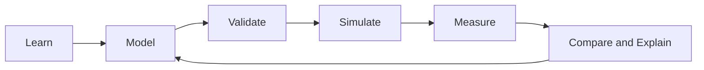
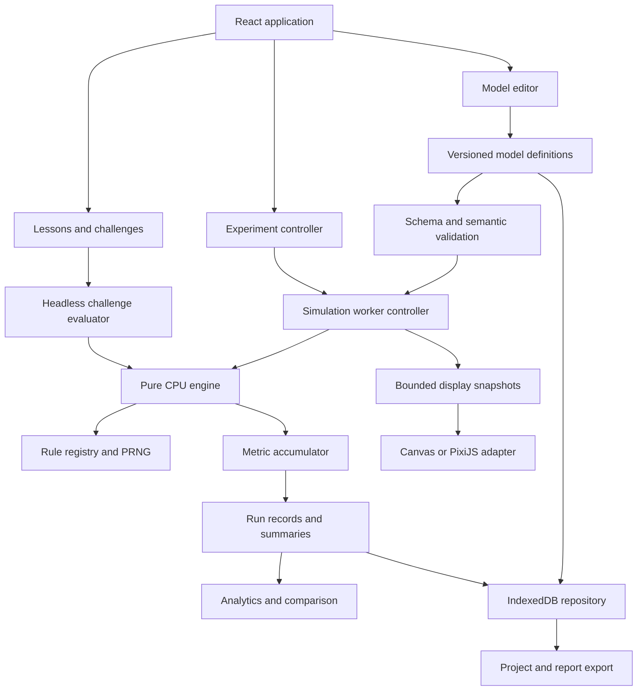

# Cellular Automata Studio — Development Plan

**Full name:** Interactive Cellular Automata Modeling, Simulation and Experimentation Environment  
**Course:** Modelling and Simulation  
**Application type:** Local-first educational web application  
**Audience:** Undergraduate and graduate students, instructors, and implementation agents  
**Specification version:** 1.0  
**Research date:** 10 November 2026  
**Status:** Implementation specification; no application features are claimed as completed.

This plan follows the supplied **BPMN Studio `PLAN(2).md`** pattern: application overview, functional modules, technical architecture, phased development, specialized development agents, collaboration rules, and a master implementation prompt. It extends that pattern with precise cellular automaton semantics, versioned data contracts, scientific experiment requirements, and executable acceptance cases. Every roadmap checkbox is intentionally unchecked.

## Contents

1. [How to use this plan](#1-how-to-use-this-plan)
2. [Application overview](#2-cellular-automata-studio--application-overview)
3. [Functional modules](#3-cellular-automata-studio--functional-modules)
4. [Technical architecture and JavaScript library research](#4-cellular-automata-studio--technical-architecture)
5. [Development roadmap](#5-cellular-automata-studio--development-roadmap)
6. [Development agents and master prompt](#6-development-agents)
7. [Normative simulation semantics](#7-normative-simulation-semantics)
8. [Data contracts and interoperability](#8-data-contracts-and-interoperability)
9. [Verification and acceptance specification](#9-verification-and-acceptance-specification)
10. [Delivery, risks, and definition of done](#10-delivery-risks-and-definition-of-done)
11. [Research notes and source register](#11-research-notes-and-source-register)

---

# 1. How to Use This Plan

## 1.1 Requirement language

- **MUST** identifies a release requirement for the feature's assigned phase.
- **SHOULD** identifies a preferred implementation; deviations require a recorded reason.
- **MAY** identifies an optional extension.
- **P0** is the minimum usable teaching application, delivered by Phases 0–2.
- **P1** is the complete course release, delivered by Phases 3–6.
- **P2** is an explicitly deferred research or product extension.

Priority is about delivery scope, not scientific accuracy. Every implemented feature, including a prototype, must report its actual semantics and limitations. A P2 feature is not required to finish P0 or P1.

This document specifies the intended application, not a claim that the proposed performance targets have already been measured. Library capabilities are sourced; stack choices, performance budgets, and product decisions are engineering recommendations.

## 1.2 First implementation assignment

Read Sections 4, 7, 8, and 9 before coding. Then implement the Phase 0 contracts and one complete Phase 1 vertical slice:

> Open a bundled Conway blinker, inspect its rule, advance exactly one generation, inspect one cell's transition, reset, edit, save, reload, and obtain the same state.

Do not build all panels as placeholders before this workflow works. Do not substitute a prerecorded animation or random visual effect for the simulation engine.

## 1.3 Default assumptions

- English interface and teaching content, with strings organized for later localization.
- Desktop and laptop browsers are the primary authoring environment; tablet use is supported, and phones provide a compact learning/viewing experience.
- No account, payment, backend, cloud database, or external AI service is required.
- Models and progress remain in the browser unless the user exports them.
- A static host serves the application. HTTPS is required for production and optional browser capabilities that require a secure context.
- A course session should work offline after the application and bundled content have been cached. First-time offline loading is not promised.
- The initial scope is finite square lattices and finite one-dimensional rings/lines. An effectively infinite universe, hexagonal grids, and three-dimensional automata are P2.
- A single implementation agent can perform all development roles sequentially. Parallel agent work is an optional execution arrangement, not a dependency of the product.

---

# 2. Cellular Automata Studio — Application Overview

## 2.1 Vision

Cellular Automata Studio should help students connect local update rules to global behavior, and then turn visual observations into reproducible modeling experiments.

Students should be able to:

- Understand cells, discrete states, neighborhoods, boundaries, and update schedules.
- Construct initial configurations and inspect transition rules.
- Simulate one-dimensional, two-dimensional, deterministic, and stochastic automata.
- Explain a specific cell's change using the exact neighborhood and rule that produced it.
- Measure population, activity, spreading, extinction, and other model-specific outcomes.
- Compare alternative assumptions while controlling initial conditions and randomness.
- Run independent replications and parameter sweeps.
- Distinguish a visual pattern from statistical evidence or a scientific conclusion.
- Export models, checkpoints, metrics, and a reproducible experiment report.
- Complete guided exercises that assess behavior and reasoning.

### Core learning cycle



## 2.2 Learning outcomes

| Outcome | Observable evidence |
|---|---|
| Explain local-to-global emergence | Predict and explain at least three cell transitions, then relate them to the resulting pattern |
| Specify a computational model | Identify state space, lattice, neighborhood, boundary, rule, initial condition, and update schedule |
| Distinguish deterministic and stochastic behavior | Reproduce a seeded run and explain why independent seeds give different realizations |
| Design a controlled experiment | Change one factor, preserve other assumptions, and record the comparison protocol |
| Recognize numerical and modeling limitations | Identify finite-size effects, boundary effects, unsupported rules, and misleading metrics |
| Interpret simulation data | Report a metric with its definition, time window, replicate count, and uncertainty where applicable |
| Communicate reproducibly | Export a project and experiment report that another student can rerun |

## 2.3 Scope and release boundaries

| Release | Included | Excluded from that release |
|---|---|---|
| P0 teaching foundation | Life-like binary rules, elementary CA, grid editor, CPU worker engine, Canvas renderer, contextual explanations, core validation, local persistence, basic metrics, JSON and binary RLE interchange, six short lessons and four challenges | Stochastic batches, custom multistate rules, continuous models, GPU computation |
| P1 course release | Brian's Brain, cyclic CA, explicitly defined forest-fire and spatial SIR models, bounded rule-table editor, experiment runner, independent replications, comparison, reports, complete curriculum, offline cache, accessibility and performance verification | Arbitrary user JavaScript, high-stakes forecasting, unbounded universes, cloud collaboration |
| P2 extensions | GPU kernels, continuous-state reaction–diffusion, asynchronous update studies, hexagonal/3D grids, agent-based extensions, more advanced spatial statistics, instructor authoring | No commitment until separately scoped and tested |

Rule 184 is included through the elementary CA engine. Its traffic interpretation is taught on a periodic ring. Forest fire and SIR are pedagogical models with deliberately simplified mechanisms, not calibrated wildfire or public-health forecasting tools.

## 2.4 Primary user journeys

1. **Explore:** choose a preset → read assumptions → predict → step → explain → inspect metrics.
2. **Create:** choose a model family → set rule and boundaries → paint an initial state → validate → save.
3. **Experiment:** state a hypothesis → select outcome and factors → configure seeds/replications → run → interpret → export.
4. **Compare:** duplicate a baseline → change one assumption → run both under a declared comparison design → explain differences.
5. **Learn:** open a lesson → use a miniature model → answer a check → receive feedback → continue.
6. **Submit:** complete a challenge → export project, assessment evidence, and reflection for the instructor.

---

# 3. Cellular Automata Studio — Functional Modules

## 3.1 Module A: Interactive Automaton Modeler

### Objective

Provide a visual workspace for specifying a complete, inspectable cellular automaton model.

### Core features

- Create, rename, duplicate, delete, and organize local projects.
- Select a model family and display its supported capabilities.
- Edit dimensions, state labels, palette, neighborhood, boundaries, and parameters.
- Paint, erase, draw a line/rectangle, fill a selection, clear, and seed a random initial state.
- Stamp bundled patterns; rotate or reflect a pattern with a visible preview.
- Select, copy, paste, move, and delete a rectangular region.
- Undo/redo user edits; group each pointer gesture into one undoable action.
- Zoom, pan, fit, and show/hide grid lines and coordinates.
- Import/export project JSON; import/export the supported binary RLE subset.
- Autosave committed edits and show saving, saved, and failed states.
- Light/dark themes and accessible state palettes.

### Model families

| Family | States | Neighborhood | Priority |
|---|---:|---|---|
| Life-like outer-totalistic | 2 | Moore radius 1, center excluded | P0 |
| Elementary CA | 2 | Left, center, right in 1D | P0 |
| Brian's Brain | 3 | Moore radius 1, center excluded | P1 |
| Cyclic CA | 3–16 | Moore or von Neumann radius 1 | P1 |
| Forest-fire teaching model | Empty, tree, burning | Moore or von Neumann radius 1 | P1 |
| Spatial SIR teaching model | Susceptible, infected, recovered | Moore or von Neumann radius 1 | P1 |
| Declarative count-based rule table | 2–8 | Moore or von Neumann radius 1 | P1 |
| Gray–Scott reaction–diffusion | Two continuous concentrations | Finite-difference stencil | P2; separate solver |

Model-family controls must prevent incompatible combinations. Changing a rule or dimension creates a new model revision; it never rewrites the metadata of an already completed run.

### Editing behavior

- Editing requires a paused simulation. A drawing action during playback first requests pause and waits for acknowledgment.
- Edits to generation zero modify the initial condition. Editing a later generation offers **Use current state as a new initial condition**, creating a new revision and resetting generation to zero.
- Reset restores the selected revision's saved initial state and initial random-stream states.
- Randomize uses a visible initialization seed and explicit state probabilities. The resulting concrete cells are also stored.
- Changing a seed alone does not silently replace visible cells; the user invokes Randomize or starts an experiment with regenerated initialization.
- A brush is clipped to the visible finite lattice even when the simulation topology is periodic. Wrapping a brush is not the default.
- Pattern transformations change cells, not the rule. Warn when a transformation changes the intended direction of an anisotropic rule such as traffic.
- Resizing defaults to centered crop/pad with state 0; show the resulting dimensions and any cropped live/nonzero cells before committing. Cancel preserves the old model.

### Contextual cell inspector

Show coordinate, current state, neighborhood stencil, neighbor counts by state, applicable rule clause, predicted next state, and boundary mapping for out-of-bounds positions. In stochastic models, distinguish a probability preview from an observed transition and its sampled value.

### Acceptance criteria

- A student can create and save a blinker without editing source code.
- Reopening a saved project restores cells, rule, boundaries, labels, and viewport.
- Undo restores a complete stroke, including a stroke drawn while zoomed or panned.
- The interface never offers Run for a configuration the selected engine cannot execute.

## 3.2 Module B: Learning Mode and Concept Encyclopedia

### Objective

Teach simulation concepts through short explanations and manipulable examples.

### Learning levels

| Level | Concepts | Required activities |
|---|---|---|
| 1. Foundations | State, lattice, local rule, discrete time, initial condition | Paint a seed; predict a next state; distinguish a frame from a generation |
| 2. Neighborhoods and boundaries | Moore, von Neumann, periodic and fixed exterior | Trace a corner neighborhood; compare a crossing glider |
| 3. Deterministic dynamics | Still life, oscillator, moving pattern, elementary rules | Identify a block/blinker; compare Rules 30 and 90 |
| 4. Modeling choices | Update schedule, finite-size effects, conservation | Explain synchronous updates; test Rule 184 car conservation |
| 5. Stochastic systems | Probabilities, seeds, extinction, replication | Reproduce a forest-fire or SIR run; compare independent realizations |
| 6. Experimentation | Hypothesis, factor, response, sampling, uncertainty | Run a small sweep; report a conclusion with limitations |

Each lesson MUST contain an objective, a concise explanation, a runnable example, a prediction prompt, a typical mistake, an exercise, a knowledge check, and a reflection. Explanations must link to the exact configuration used by the demonstration.

Progress records completion and attempt history locally. Optional badges must reinforce learning rather than replace feedback. Time spent or button clicks alone do not establish mastery.

### Minimum content inventory

P0: six lessons covering the first three levels, four guided challenges, and eight presets. P1: twelve lessons, ten challenges, and at least sixteen presets, with at least one example for every supported family.

Suggested presets: block, blinker, toad, beacon, glider, a small HighLife seed, Rules 30 and 90, Rules 110 and 184, Brian's Brain excitation, cyclic random lattice, forest-fire front, forest-fire regrowth, isolated SIR infection, and a custom count-rule example. Validate every preset against its stated rule; names alone are not evidence of expected behavior.

## 3.3 Module C: Model Validator

### Objective

Separate parse errors, invalid model definitions, unsupported execution capabilities, and educational advice.

### Validation categories

| Category | Examples | Required behavior |
|---|---|---|
| File/schema | Missing version; malformed data; inconsistent byte count | Reject import with a precise path and message |
| Structural | Invalid dimensions; cell values outside state range; wrong 1D height | Block execution |
| Rule semantics | Invalid B/S digit; ECA rule outside 0–255; incomplete/overlapping count table | Block execution |
| Capability | Unsupported schedule, stencil, family, or export format | Name the unsupported combination and supported alternatives |
| Experiment | Zero runs; invalid probabilities; sample interval exceeding horizon; excessive work | Block or require reduced workload, depending on issue |
| Educational | Dense seed near a fixed boundary; too few replications; confounded comparison | Explain implications without calling the model invalid |

### Issue contract

Each issue includes stable code, severity, category, affected field or cell region, plain-language explanation, likely consequence, suggested correction, and related lesson. Severity values are `error`, `warning`, `recommendation`, and `information`.

The validator MUST distinguish **valid description**, **supported by this engine**, and **appropriate for a stated investigation**. A syntactically valid custom rule need not be scientifically useful. A visually unfamiliar outcome need not indicate a bug.

No heuristic may claim to prove chaos, universality, self-organized criticality, or a phase transition. Present such topics as hypotheses or established external results with appropriate sources, not automatic labels derived from a short animation.

## 3.4 Module D: Simulation and Explainable Execution

### Objective

Run the actual model and make individual transitions understandable.

### Controls and semantics

| Control | Required behavior |
|---|---|
| Play | Advance at a requested generations-per-second rate; report achieved rate |
| Pause | Finish the current generation, acknowledge its number, and stop advancing |
| Step | Advance exactly one generation while paused |
| Step N | Advance exactly N generations or stop on an explicitly selected termination condition |
| Reset | Restore initial cells, generation zero, and initial random streams |
| Speed | Change scheduling only; never change transition rules or random draws |
| Stop batch | Cancel further experiment work; preserve completed and explicitly marked partial results |
| Inspect | Explain a selected cell using the relevant source generation |
| Scrub history | P1: replay from a stored checkpoint; never imply that the rule is mathematically reversible |

### Inspection panel

Display model revision, rule summary, generation, requested/actual speed, boundary, update schedule, engine/backend, running state, selected-cell information, and any numerical/runtime error. Show simulation generation independently of display refresh rate.

For Life, explain that the old cell state and old neighbor count determine the new state. For ECA, highlight the exact three-bit neighborhood and rule bit. For stochastic models, record the applicable event probability and draw for the selected transition without consuming extra random values.

### History and branching

Keep a bounded history rather than a full grid for every generation. Default checkpoint interval: 100 generations; default checkpoint ring budget: 16 MiB. Store PRNG state and model revision with every checkpoint. If the user rewinds and edits, create a new branch/revision. Do not mutate prior run evidence.

P0 needs reset and step, not backward scrubbing. P1 replay must reproduce exact discrete CPU states from an available checkpoint. If a generation is outside retained history, offer replay from generation zero or explain that it is unavailable.

### Runtime behavior

Pause interactive simulation when the tab becomes hidden, and explain this when it returns. Batch experiments may continue when possible, but must not claim real-time timing guarantees in a throttled background tab. Computation errors halt the run and retain a diagnostic checkpoint; never continue with corrupted state.

## 3.5 Module E: Measurement and Experimentation

### Objective

Turn model exploration into controlled computational experiments.

### Basic measurements

- Generation and state counts/fractions.
- Changed-cell count and activity fraction between consecutive generations.
- Binary births and deaths for Life-like rules.
- State-distribution entropy, explicitly described as a histogram statistic.
- Rule 184 car count, density, and moves per road cell per generation.
- Burning fraction, tree fraction, and extinction information for forest fire.
- Susceptible/infected/recovered fractions, incident infections, and final recovered fraction for SIR.
- Optional P1 connected components with explicitly selected adjacency and topology.

Metric definitions and edge cases are normative in Section 7.8. Charts must label generation, units, sample interval, and aggregation. Display decimation must not change underlying calculations or exported measurements.

### Experiment configuration

Each experiment records:

1. Research question and hypothesis.
2. Frozen model revision and engine semantics version.
3. Factors and explicit candidate values.
4. Initial-condition policy: fixed concrete grid or regenerated per replicate.
5. Master seed and deterministic per-run seed derivation.
6. Independent replicate count and seed list.
7. Maximum generations, sample interval, and selected termination conditions.
8. Analysis window, including any explicitly justified burn-in.
9. Primary response metric and aggregation rule.
10. Resource estimate and output retention policy.

P1 supports a single run, independent replications, a one-factor sweep, and a two-factor Cartesian grid. Adaptive optimization and arbitrary parameter-search algorithms are P2.

### Scientific correctness

- A time series from one run is not a set of independent replications.
- Compute uncertainty across independent run-level outcomes, not across correlated generations.
- Default replicate summaries show count, mean, sample standard deviation, median, and min/max. A 95% Student-t interval for the mean is available when `n >= 2`, labeled as an assumption-dependent interval; flag very small samples and visibly skewed/bounded outcomes.
- Deterministic repetitions of the same initial condition do not create statistical uncertainty. Show one outcome unless initialization varies.
- Extinction-time analysis distinguishes extinction observed by the horizon from right-censored runs. Do not average unobserved extinction times as zero or as the horizon.
- Burn-in is an analysis-window choice, not a universal requirement. Never apply it automatically to transient outbreak or spread studies.
- If automatic termination occurs before the requested horizon, record actual duration and termination reason. Do not silently pad missing data.
- Use fixed-horizon comparisons by default. Early termination is permitted only when the metric's treatment of the remaining horizon is explicitly defined.

### Results and exports

Show progress by completed runs, current run/generation, elapsed wall time, and cancellation status. Preserve raw sampled data and run-level summaries separately. Export metrics CSV, experiment JSON, and a Markdown report containing question, assumptions, parameters, seed list, formulas, results, and limitations. A chart screenshot alone is not an experiment record.

## 3.6 Module F: Baseline vs. Alternative Comparison

### Objective

Help students evaluate the consequences of changing a rule, topology, initial condition, or parameter.

### Workflow

1. Freeze a baseline revision and experiment configuration.
2. Duplicate the model as an alternative.
3. Display every changed assumption.
4. Select a comparison design: independent or paired.
5. Execute both configurations using identical metric definitions and analysis windows.
6. Compare trajectories, distributions, summaries, and uncertainty.
7. Record a written interpretation.

### Comparison rules

- Side-by-side views may lock generation, pan, and zoom independently.
- Hamming distance is available only for aligned lattices with compatible categorical state meanings.
- Different grid sizes require normalized metrics; direct cell-to-cell distance is unavailable.
- Different state labels or families disable unsupported comparisons rather than guessing a mapping.
- Paired experiments require an explicit matched initialization/random-stream design. Merely entering the same seed does not prove useful pairing across unrelated model algorithms.
- P1 supports paired comparisons within the same family, dimensions, stochastic draw protocol, and replicate identity. Otherwise default to independent runs.
- For paired outcomes, summarize per-pair differences; for independent outcomes, summarize each group and label any comparison method used.
- Relative change is `(alternative - baseline) / abs(baseline) * 100`. If baseline is zero, show absolute change and `N/A` for percentage.
- Do not label larger or smaller values as an improvement without an explicit objective.

### Educational questions

Did the effect persist across seeds? Did the boundary create the effect? Was only one assumption changed? Did a larger grid alter the conclusion? Does a stationary population count conceal ongoing cell activity? Does the evidence justify the claim?

## 3.7 Module G: Guided Challenges and Assessment

### Objective

Assess understanding through construction, prediction, diagnosis, experimentation, and explanation.

### Challenge inventory

| ID | Task | Machine-checkable evidence | Human/reflection component |
|---|---|---|---|
| CA-01 | Predict one Life generation | Exact next-state fixture | Explain one birth and one death |
| CA-02 | Build a nonempty still life | Exact state equality over specified steps | Explain why cells survive |
| CA-03 | Build a period-two oscillator | `S0 == S2` and `S0 != S1` | Explain the two phases |
| CA-04 | Diagnose a boundary difference | Correct selected boundary and predicted edge transition | Explain wraparound |
| CA-05 | Encode an elementary rule | Correct eight outputs and rule number | Explain bit ordering |
| CA-06 | Reproduce a stochastic run | Matching version, seeds, checkpoint, and state | Explain reproducibility limits |
| CA-07 | Investigate traffic density | Car conservation and complete sweep metadata | Interpret density versus flow |
| CA-08 | Compare spread assumptions | Valid independent replicated experiments | Identify confounders and uncertainty |
| CA-09 | Repair an invalid rule table | Complete, nonoverlapping transition specification | Explain the original conflict |
| CA-10 | Submit a modeling investigation | Valid project/report and required evidence fields | Instructor assesses scientific reasoning |

### Assessment principles

Assess behavior and declared constraints rather than exact drawings. For a still-life challenge, multiple configurations are valid; require nonempty cells and any specified size/population limits. Translation or rotation equivalence is enabled only when the task permits it and the rule supports it.

Challenge fixtures are immutable. Evaluate a snapshot through the same tested headless engine used by the app. Each predicate returns passed/failed, observed value, expected condition, explanation, and a progressive hint. Do not conceal which model semantics were used.

Written explanations receive a rubric and instructor review or student self-assessment. P1 does not pretend that keyword matching reliably grades reasoning. Local challenge results are formative feedback, not tamper-proof examination records.

---

# 4. Cellular Automata Studio — Technical Architecture

## 4.1 JavaScript Simulation and Rendering Library Research

**Recommendation:** build the discrete CA engine in TypeScript using typed arrays and a Web Worker. Start with a native Canvas 2D renderer. Keep a renderer interface so PixiJS can be introduced after profiling. Use React, TypeScript, and Vite for the application, Dexie for IndexedDB, seedrandom for deterministic stochastic streams, and Recharts for course-scale analytics.

Simulation and rendering are different responsibilities. A library that displays a grid efficiently does not automatically implement correct cellular automaton updates, random-stream persistence, experiment design, or assessment.

### Candidate comparison

The fit judgments below are design assessments for this application, not measured benchmark results.

| Candidate | Documented role and strengths | Fit and limitations for this project | Decision |
|---|---|---|---|
| Native Canvas 2D + typed arrays | Browser drawing API suitable for pixel-backed 2D views; no third-party renderer dependency. [Canvas API](https://developer.mozilla.org/en-US/docs/Web/API/Canvas_API) | Direct mapping from categorical states to pixels; application must supply interaction, transforms, and accessibility | **P0 default renderer**; build one reusable adapter |
| PixiJS | 2D renderer with WebGL/WebGPU backends, textures, scene objects, and interaction support. [Renderer guide](https://pixijs.com/8.x/guides/components/renderers) | Strong candidate for a polished zoomable view and overlays; avoid one sprite per cell; does not supply CA semantics | **Preferred optional rendering upgrade**, conditional on profiling |
| p5.js | Sketch-oriented canvas API with 2D and WebGL modes. [createCanvas reference](https://p5js.org/reference/p5/createCanvas/) | Excellent for standalone classroom sketches and quick prototypes; embedding a separate sketch lifecycle adds integration work to this React application | Use for separate teaching examples if desired; not the production core |
| regl | Functional WebGL library exposing GPU drawing operations. [Official repository](https://github.com/regl-project/regl) | Suitable for an expert-owned texture/shader implementation; requires lower-level GPU code and careful state handling | P2 alternative to a direct WebGL adapter; do not combine unnecessarily with PixiJS |
| GPU.js | Compiles supported JavaScript kernels for accelerated execution and documents CPU fallback. [Official repository](https://github.com/gpujs/gpu.js) | Potential experiment for dense stencil computation; supported JavaScript subset, actual backend, precision, transfer cost, and package version require validation | P2 compute spike, behind the CPU reference interface |
| Three.js | 3D rendering ecosystem; its WebGPU renderer also describes a WebGL 2 rendering fallback. [Official renderer manual](https://threejs.org/manual/pages/webgpurenderer) | Useful for 3D automata or spacetime volumes; unnecessary complexity for the primary 2D lattice | P2 3D extension; a renderer fallback does not guarantee compute-kernel equivalence |
| Native WebGPU | Browser graphics and compute API. [WebGPU API](https://developer.mozilla.org/en-US/docs/Web/API/WebGPU_API) | Offers a path to explicit compute kernels; requires capability detection, shader code, device-loss handling, and fallback | P2 only; never a course-access prerequisite |
| AgentScript | JavaScript agent-based modeling with patches, turtles, links, and separated model/view/control components. [Official documentation](https://agentscript.org/) | Valuable if the course expands to mobile agents or hybrid models; broader semantics than the small auditable CA kernel needed here | Reference or later ABM integration, not a mandatory dependency |
| NetLogo Web | Browser-based modeling environment supporting NetLogo models and web delivery. [Official FAQ](https://netlogo-web.org/docs/faq) | A credible alternative if the goal becomes teaching existing NetLogo models; adopting it changes the product architecture and authoring language | Evaluate as an alternative product direction; do not embed its entire runtime by default |
| Recharts | React chart components built on SVG. [Official site](https://recharts.github.io/) | Good fit for moderate sampled time series and educational dashboards; bound rendered points and disable gratuitous animation | **P0/P1 analytics default** |
| uPlot | Canvas-based charting focused on time series. [Official repository](https://github.com/leeoniya/uPlot) | Attractive if long or dense traces exceed the chart budget; imperative lifecycle needs a React wrapper | Alternative only after a measured Recharts bottleneck |
| D3 | Modular visualization toolkit. [Official introduction](https://d3js.org/what-is-d3) | Useful for specialist scales, contours, or custom plots; more implementation work than needed for ordinary course charts | Select individual modules only for a concrete need |

### Important research qualifications

PixiJS documentation is not perfectly synchronized: the renderer guide lists Canvas support as forthcoming, while the **4 February 2026 v8.16.0 announcement** documents an experimental Canvas renderer. Therefore, do not base accessibility to the course on assumptions about an unspecified PixiJS version. Keep the independent Canvas adapter and test the exact locked release. [PixiJS v8.16.0 announcement](https://pixijs.com/blog/8.16.0)

NetLogo Web documents differences from desktop NetLogo, including unavailable features such as BehaviorSpace at the time of this research. Do not assume that its browser runtime supplies this plan's experiment runner. [Official differences](https://netlogo-web.org/docs/differences)

GPU.js repository documentation can describe development-branch capabilities beyond a published package. The plan does not depend on those capabilities. Any adoption spike must verify the installed package, browser, actual backend, correctness, and total end-to-end cost.

No library was benchmarked or installed as part of writing this specification. Performance rankings, unsupported-platform claims, and dependency health must not be inferred from popularity or repository stars.

### Why a custom engine is appropriate

The required discrete rules are small, auditable local functions. A custom engine makes update order, boundaries, seeded randomness, checkpoints, and explanation traces explicit. A generic physics engine or discrete-event scheduler does not remove these responsibilities. The baseline uses synchronous discrete generations, not a queue of physical collisions or stochastic event times.

The custom engine is deliberately narrow: finite lattices, declared states, bounded neighborhoods, and tested rule families. Do not attempt a universal simulation framework before the course workflows work.

## 4.2 Recommended Stack

| Layer | Choice | Responsibility |
|---|---|---|
| Application | React + TypeScript | Accessible panels, editor controls, learning and experiments |
| Build | Vite | Development/build pipeline and module-worker bundling |
| State | React state/reducers for UI; worker-owned engine state | Keep high-frequency grids outside React reconciliation |
| Discrete simulation | Custom TypeScript | Exact, versioned rule semantics and metrics |
| Storage buffers | `Uint8Array` with double buffering | Categorical states; P1 limits fit within one byte |
| Execution | Dedicated Web Worker | Keep UI responsive and reuse headless engine |
| Renderer | Native Canvas 2D | Pixel grid plus lightweight overlays |
| Optional renderer | PixiJS | Add only when measured benefit justifies it |
| Randomness | seedrandom through an owned adapter | Explicit seeded streams and saved PRNG state |
| Analytics | Recharts | Sampled trajectories and replicate summaries |
| Persistence | Dexie + IndexedDB | Projects, revisions, runs, checkpoints, progress |
| Runtime validation | JSON Schema + Ajv | Versioned import validation and semantic checks |
| Rule editing | Form-based table first; CodeMirror optionally later | Declarative configuration, never arbitrary execution |
| Unit/integration tests | Vitest | Kernels, contracts, storage, statistics |
| Browser tests | Playwright | Critical student workflows across browser engines |

Supporting evidence: seedrandom documents state saving/restoration; Dexie documents IndexedDB use and React live queries; Ajv provides JSON Schema validation; Vitest and Playwright document the proposed test layers. [seedrandom](https://github.com/davidbau/seedrandom), [Dexie React guide](https://dexie.org/docs/Tutorial/React), [Ajv guide](https://ajv.js.org/guide/getting-started.html), [Vitest](https://vitest.dev/guide/), [Playwright](https://playwright.dev/docs/intro)

If a text rule editor becomes useful, CodeMirror is a candidate editor component, not a security boundary or rule interpreter. [CodeMirror repository](https://github.com/codemirror/dev)

Use native typed worker messages initially. Comlink is a reasonable optional adapter for coarse operations, but per-cell remote calls are prohibited. Its default cloning behavior and explicit transfer mechanism must be understood before adopting it. [Comlink](https://github.com/GoogleChromeLabs/comlink)

Pin exact resolved dependencies in the lockfile. Phase 0 records the package versions, compatible Node version, browser baseline, license identifiers, and attribution obligations. Do not prescribe an unverified future “latest” version or make unsupported license conclusions in this plan.

## 4.3 Architecture Principles

1. Pure model semantics are independent of React, Canvas, workers, and persistence.
2. The CPU implementation is the correctness reference for every discrete backend.
3. Simulation speed and rendering frequency never alter model behavior.
4. A run binds to an immutable model revision and a semantics version.
5. Randomness, initialization, and stopping criteria are explicit data.
6. The UI displays supported capability combinations and actionable limitations.
7. Every exported result includes enough provenance to interpret and rerun it.
8. Rendering, analytics, assessment, and learning consume the same model definitions.
9. Persistence failures must be visible and must not discard the in-memory project.
10. Implement complete vertical slices and verify behavior before broadening scope.

## 4.4 Logical Architecture



## 4.5 Suggested Project Structure

```text
cellular-automata-studio/
├── src/
│   ├── app/                  # routes, layout, global error handling
│   ├── components/           # accessible shared UI
│   ├── features/
│   │   ├── modeler/
│   │   ├── learning/
│   │   ├── validation/
│   │   ├── simulation/
│   │   ├── analytics/
│   │   ├── experiments/
│   │   ├── comparison/
│   │   └── challenges/
│   ├── domain/
│   │   ├── contracts/        # shared types and capability descriptors
│   │   ├── lattice/          # indexing, topology, neighborhood sampling
│   │   ├── rules/            # versioned discrete rule implementations
│   │   ├── engine/           # step, reset, checkpoint, replay
│   │   ├── randomness/       # stream adapter and seed derivation
│   │   ├── metrics/
│   │   ├── experiments/
│   │   └── assessment/
│   ├── workers/              # messages, scheduling, cancellation
│   ├── renderers/            # interface, Canvas, optional PixiJS
│   ├── storage/              # Dexie schema, repositories, migrations
│   ├── interchange/          # JSON, binary RLE, CSV, Markdown reports
│   ├── schemas/              # versioned JSON Schemas
│   ├── data/
│   │   ├── presets/
│   │   ├── lessons/
│   │   └── challenges/
│   └── styles/
├── tests/
│   ├── fixtures/
│   ├── unit/
│   ├── integration/
│   ├── e2e/
│   └── benchmarks/
├── docs/
│   ├── adr/
│   ├── simulation-semantics/
│   ├── teaching-content/
│   ├── acceptance/
│   └── dependency-audit.md
├── public/
├── PLAN.md
└── README.md
```

Import rule: `domain/` must not import from `features/`, `renderers/`, `workers/`, or `storage/`. It must run in both a browser worker and the unit-test environment. UI components never contain a second implementation of a transition rule.

## 4.6 Rendering and Worker Design

### Canvas baseline

Convert categorical states to RGBA pixels with a palette lookup into a reusable `ImageData` buffer. Draw through a canvas transform with image smoothing disabled. Grid lines, selection, brush preview, and inspected neighborhood form a separate overlay. Grid lines disappear when zoom would make them illegible.

Do not allocate a React component, DOM element, SVG rectangle, or Pixi sprite per cell. Account for device pixel ratio without changing lattice coordinates. Pointer-to-cell mapping must invert the same camera transform used for drawing. Canvas resizing must preserve model state.

### Worker scheduling

- Keep simulation-owned current/next arrays inside one worker per active run.
- Process bounded batches and yield to the worker event loop at least every approximately 16 ms when feasible. Check cancellation between generations.
- A command cannot interrupt a generation halfway through its update; if a supported model cannot meet responsiveness budgets, lower its allowed size or implement safe internal chunking.
- Run the simulation at its requested rate and render the latest available completed generation at most once per animation frame.
- While catching up, skip display frames, never generations or random draws. Show achieved generations/second if the requested rate is unsustainable.
- Keep at most two unconsumed display snapshots; drop/recycle stale display frames.
- Metrics are accumulated in the worker. Charts receive batches at most four times per second.
- Dispose workers, event listeners, renderer resources, and buffers on project closure.

Transfer a dedicated snapshot buffer or a copied grid, never the worker's active current/next array. Transferring an `ArrayBuffer` moves ownership and detaches it from the sender; buffer recycling needs explicit acknowledgment. [MDN transferable objects](https://developer.mozilla.org/en-US/docs/Web/API/Web_Workers_API/Transferable_objects)

### Optional acceleration gate

Before enabling PixiJS or a GPU compute backend, show a measured benefit on the target devices, account for upload/readback costs, verify exact categorical outputs against the CPU reference, test context/device loss, and retain the CPU+Canvas path. Continuous numerical solvers may use documented tolerances; categorical kernels may not.

---

# 5. Cellular Automata Studio — Development Roadmap

Phases are dependency gates, not calendar estimates. Complete and demonstrate each gate before expanding its dependent features. The P0 release ends after Phase 2; the P1 course release ends after Phase 6.

## Phase 0: Contracts, Semantics, and Project Foundation

### Scope

- [ ] Initialize React, TypeScript, and Vite with strict type checking.
- [ ] Record dependency versions, licenses, runtime requirements, and browser targets.
- [ ] Establish the directory structure and allowed dependency directions.
- [ ] Define model, checkpoint, run, worker-message, and validation contracts.
- [ ] Write JSON Schema version 1 and import rejection fixtures.
- [ ] Record architecture decisions for finite lattices, synchronous updates, Canvas, and worker ownership.
- [ ] Configure Vitest, Playwright, linting, formatting, and production builds.
- [ ] Implement the small reference Life step and hand-verified fixtures.

### Acceptance gate

The repository builds, type-checks, and runs the reference fixtures. Contracts distinguish display state from simulation state. An architecture note explains boundaries, indexing, and the future worker ownership model. No dependency requires a secret or external service.

## Phase 1: First Complete Modeling and Simulation Slice

### Scope

- [ ] Implement Life-like B/S parsing and synchronous double-buffered stepping.
- [ ] Implement finite fixed and periodic boundaries.
- [ ] Integrate the worker command lifecycle.
- [ ] Build Canvas rendering, zoom, pan, fit, and pointer coordinate mapping.
- [ ] Add painting, erasing, clear, and undo/redo.
- [ ] Implement play, pause, step, Step N, and reset.
- [ ] Add block, blinker, and glider fixtures/presets.
- [ ] Add cell transition explanation for Life.
- [ ] Implement local save/reopen and versioned JSON import/export.
- [ ] Add state counts and activity metrics.

### Acceptance gate

The first assignment in Section 1.2 passes end to end. Blinker, block, glider, and boundary fixtures match the reference engine. Save/reload preserves cells and semantics. The UI remains usable during simulation, and Reset is deterministic.

## Phase 2: P0 Teaching Foundation

### Scope

- [ ] Implement all 256 elementary rules with a rule-bit editor and spacetime view.
- [ ] Implement binary RLE import/export and clear subset reporting.
- [ ] Add region selection, pattern stamps, transformations, and seeded random initialization.
- [ ] Complete contextual validation and capability reporting.
- [ ] Deliver six lessons, four challenges, and eight verified presets.
- [ ] Add basic metric charts and CSV export.
- [ ] Implement keyboard navigation, focused-cell editing, and text alternatives.
- [ ] Verify Chrome/Chromium, Firefox, and Safari/WebKit workflows, with a manual Safari check where available.

### Acceptance gate

A student can finish an introductory lesson, construct a model, run it, explain a transition, complete a challenge, and export the work without source-code access. ECA bit-order tests and RLE round trips pass. P0 is usable without GPU support or a backend.

## Phase 3: Stochastic and Multistate Models

### Scope

- [ ] Add Brian's Brain, cyclic CA, forest fire, and spatial SIR.
- [ ] Implement declared per-cell random draw schedules and checkpointed PRNG state.
- [ ] Add multistate palettes and state-count displays.
- [ ] Implement bounded count-based declarative rule tables and exhaustive table validation.
- [ ] Add model-specific transition explanations and metrics.
- [ ] Implement checkpoint replay and history limits.
- [ ] Add stochastic and multistate lessons/presets.

### Acceptance gate

Save/resume produces exactly the same CPU state and metrics as uninterrupted execution. Changing frame rate or batch size does not change results. Probability-zero/one fixtures and model-specific invariants pass. Unsupported custom-rule constructs are rejected before execution.

## Phase 4: Experiments and Scientific Analytics

### Scope

- [ ] Implement immutable experiment definitions and run provenance.
- [ ] Add single runs, replications, and one-/two-factor sweeps.
- [ ] Add deterministic seed derivation and reproducible run ordering.
- [ ] Implement bounded worker execution, progress, and cancellation.
- [ ] Implement run-level summaries, analysis windows, and labeled uncertainty.
- [ ] Distinguish observed extinction from censoring.
- [ ] Export raw metrics CSV, experiment JSON, and Markdown reports.
- [ ] Add storage estimates and workload limits before launch.

### Acceptance gate

A saved experiment can be rerun with identical discrete outputs for the same pinned semantics. Replicates use distinct streams. A cancelled sweep keeps completed results and labels unfinished work. Exported statistics match independently calculated fixture values.

## Phase 5: Comparison and Complete Learning Experience

### Scope

- [ ] Implement baseline/alternative revision comparison and assumption diffs.
- [ ] Add compatible paired and independent experiment designs.
- [ ] Add side-by-side views, normalized outcomes, and compatible Hamming distance.
- [ ] Deliver twelve lessons, ten challenges, and sixteen verified presets in total.
- [ ] Add progressive hints, explainable predicates, and local progress tracking.
- [ ] Add student investigation/report templates and instructor-facing rubrics.
- [ ] Complete replay, branching, and result provenance workflows.

### Acceptance gate

A student can make a controlled comparison and export the supporting evidence. Incompatible comparisons are disabled with explanations. Multiple behaviorally correct challenge solutions are accepted. Reflection remains explicitly separate from automated checks.

## Phase 6: Course Release, Reliability, and Performance

### Scope

- [ ] Run cross-browser acceptance and manual accessibility reviews.
- [ ] Verify the declared performance budgets on documented devices.
- [ ] Verify offline loading after caching and controlled application updates.
- [ ] Test quota failures, migrations, crash recovery, and worker errors.
- [ ] Audit dependencies, bundled content provenance, and attribution.
- [ ] Optimize measured bottlenecks; evaluate PixiJS only if justified.
- [ ] Publish supported-capability and known-limitation documentation.
- [ ] Complete README, deployment instructions, and acceptance evidence.

### Acceptance gate

All P1 acceptance requirements pass, or a capability is explicitly removed from the release scope rather than presented as working. No silent data loss, fake results, unexplained unsupported controls, or undocumented numerical behavior remains.

## Phase 7: Optional Research Extensions — P2

- [ ] Prototype deterministic GPU kernels and CPU parity tests.
- [ ] Add a separate Gray–Scott solver with numerical validation.
- [ ] Explore asynchronous schedules with explicitly different semantics.
- [ ] Explore hexagonal grids, 3D lattices, or agent-based hybrids.
- [ ] Explore sparse/unbounded Life algorithms and advanced pattern detection.
- [ ] Add instructor scenario authoring or external course-system integration if separately required.
- [ ] Consider an optional AI tutor only with explicit product scope, privacy behavior, and validated explanations.

No P2 checkbox blocks completion of the core course application. Each extension needs its own contract, resource budget, acceptance fixtures, and limitations before exposure in the UI.

---

# 6. Development Agents

## 6.1 Agent Structure and File Ownership

These roles may be assigned to separate development agents or performed sequentially. Shared interfaces must be agreed before work is divided.

| Role | Owned areas | Required deliverables | Depends on |
|---|---|---|---|
| Agent 1: Architecture and integration | `domain/contracts`, schemas, build/config, architecture notes | Versioned contracts, capability registry, integrated release, architecture decisions | None; establishes foundations |
| Agent 2: Modeler and rendering | `features/modeler`, renderers, editor interaction | Correct coordinate mapping, edit commands, Canvas adapter, accessible inspection | Contracts and model capabilities |
| Agent 3: Simulation and reproducibility | lattice, rules, engine, randomness, workers | Reference kernels, PRNG protocol, lifecycle, checkpoints, replay, engine fixtures | Contracts and agreed semantics |
| Agent 4: Educational experience | learning, challenge content, assessment presentation | Lessons, runnable examples, rubrics, progressive feedback | Engine and evaluator contracts |
| Agent 5: Experiments and analytics | metrics, experiments, comparison, reports | Formulas, seed assignment, batch execution, charts, exports, statistical fixtures | Engine and run contracts |
| Agent 6: Quality and interoperability | independent test fixtures, acceptance docs; coordinates storage/interchange reviews | Cross-browser checks, round trips, migration/failure tests, benchmark evidence | All completed vertical slices |

Assign a named owner for `storage/` and `interchange/` at kickoff; default to Agent 1 with Agent 5 owning result/report serialization. Test ownership does not relieve feature owners from writing meaningful correctness tests.

## 6.2 Collaboration Rules

1. Read the full plan and inspect the repository before modifying files.
2. Agree on interfaces, semantics versions, and file ownership before concurrent work.
3. One owner changes shared contracts, package manifests, and database migrations at a time.
4. Propose contract changes with affected producers/consumers and migration implications.
5. Implement in small vertical slices; integrate working behavior frequently.
6. Use the CPU reference engine for simulations, assessment, and deterministic comparisons.
7. Never duplicate rule logic in the renderer, UI, or challenge content.
8. Do not silently replace required semantics with a visually similar approximation.
9. Keep unsupported features visible in capability documentation and absent/disabled in executable controls.
10. Record assumptions and deviations in architecture decisions and update this plan when scope changes.
11. Submit tests with concrete expected outcomes; do not rely only on screenshots or a second copy of the same algorithm.
12. Check off a task only after its acceptance evidence exists.
13. Preserve existing user work, saved models, and unrelated repository changes.
14. Resolve dependencies before broadening scope; a failure in a core invariant takes precedence over cosmetic expansion.

## 6.3 Standard Agent Work Packet

Every assigned task should specify:

```text
Task ID and phase:
User-visible outcome:
Owned files/modules:
Upstream contracts and versions:
Exact supported semantics:
Inputs and outputs:
Acceptance fixture or student workflow:
Performance/accessibility constraints:
Out-of-scope items:
Handoff evidence: changed files, checks run, results, limitations, migration impact.
```

Agents must report failed checks as failures. A passing build is not proof that simulation or statistical behavior is correct. Do not claim a browser was tested unless it was actually exercised.

## 6.4 Master Agent Prompt

> Build **Cellular Automata Studio**, an interactive university-level application for a Modelling and Simulation course, following this PLAN.md.
>
> Use React, TypeScript, Vite, a pure custom TypeScript cellular automaton engine, typed arrays, a Web Worker, native Canvas 2D, Dexie/IndexedDB, seedrandom behind an owned adapter, JSON Schema/Ajv, Recharts, Vitest, and Playwright. Pin and verify exact dependencies. Introduce PixiJS or GPU computation only after a measured need and correctness validation.
>
> Start by reading the semantics, contracts, and acceptance sections. Establish interfaces and implement one complete vertical slice: load a Life blinker, step once, explain a cell transition, reset, edit, save, reload, and verify identical state. Then proceed through the roadmap gates.
>
> The application must support learning, model construction, validation, real simulation, measurements, controlled experiments, comparisons, and explainable challenges. P0 contains Life-like rules and elementary CA. P1 adds the specified multistate and stochastic families, declarative count rules, experiments, complete learning content, and reliability work. P2 extensions are deferred.
>
> Keep model semantics independent of UI, rendering, persistence, and worker scheduling. Use synchronous double buffering, explicit finite boundaries, immutable model revisions, deterministic random streams, and versioned checkpoints. A generation is a model step, not a display frame.
>
> Never use Math.random for scientific runs, never execute imported JavaScript, and never consume extra random draws to explain a transition. Preserve seeds, PRNG states, engine versions, stop criteria, and initial cells in reproducibility records.
>
> Validate rule capabilities before execution. Do not claim an infinite universe, reversible evolution, universal GPU parity, formal chaos detection, or real-world forecasting accuracy. Treat Gray–Scott as a separate continuous solver if later implemented.
>
> Prioritize scientific correctness, educational clarity, accessibility, responsive interaction, and local data reliability. Test concrete transition fixtures, invariants, checkpoint replay, import/export, cancellation, and complete student workflows. Record measured performance and actual browser coverage.
>
> For every completed phase, update acceptance evidence and documentation. Keep incomplete roadmap items unchecked. Deliver working code, reproducible examples, setup/build instructions, supported capabilities, and known limitations. Continue through the authorized release scope; do not treat a polished mockup as the completed application.

---

# 7. Normative Simulation Semantics

This section defines the application's actual models. Named teaching variants must be identified by their versioned rule IDs; similar names in other simulators do not imply identical behavior.

## 7.1 Lattice, State, and Time

- Coordinates are zero-based: `x` increases rightward and `y` downward; `(0,0)` is the top-left cell.
- Flatten a two-dimensional lattice as `index = y * width + x`.
- Discrete cells use integer state IDs `0..stateCount-1`, stored in a `Uint8Array`.
- P0/P1 2D dimensions are 3–1024 per axis, subject to the resource budgets in Section 9.4. The default is 128 × 128.
- ECA has height 1 and width 3–4096. Its spacetime picture is history, not an extra spatial dimension. Default width is 255.
- Minimum dimensions prevent a radius-one periodic stencil from mapping different neighbor offsets to the same physical cell. Degenerate smaller worlds are unsupported in version 1.
- Generation zero is the concrete initial state. `step()` maps generation `t` to `t+1` exactly once.
- All P0/P1 families use synchronous updates: read only the old grid, write every new cell to a separate buffer, then swap.
- Never update the old grid in place. Different loop orders must give the same result for deterministic rules.
- Model time is measured in generations. A real-world time unit is not implied unless a future calibrated model explicitly defines it.

## 7.2 Neighborhoods and Boundaries

**Moore radius 1:** eight offsets `(-1,-1),(0,-1),(1,-1),(-1,0),(1,0),(-1,1),(0,1),(1,1)`; center excluded.

**Von Neumann radius 1:** four offsets `(0,-1),(-1,0),(1,0),(0,1)`; center excluded.

**Elementary:** ordered left, center, right, including the center as part of the three-bit rule input.

Supported boundary types:

1. **Periodic:** map an index `v` into size `n` using `((v % n) + n) % n`. This is a torus in 2D or ring in 1D.
2. **Fixed exterior:** every out-of-bounds sample returns a declared valid state ID, default 0. Edge cells inside the grid still update normally; they are not pinned.

Fixed exterior is a property of sampling, not a frozen border row. Neighborhood counts include the prescribed exterior samples. A nonzero fixed exterior can therefore supply active or infected neighbors and must be shown clearly.

Reflection, edge clamping, open traffic injection/removal, and arbitrary graph neighborhoods are not aliases for these boundaries and are not supported in P0/P1. A bounded finite simulation does not emulate an infinite universe, especially for rules that create cells in an empty background.

## 7.3 Deterministic Rule Families

### Life-like outer-totalistic — `life-like/v1`

Let `c` be the old binary state and `n` the number of live cells in the eight-cell Moore neighborhood. A dead cell becomes 1 exactly when `n` is in the birth set; a live cell remains 1 exactly when `n` is in the survival set; otherwise it becomes 0. Canonical syntax is `B<sorted unique digits>/S<sorted unique digits>`, digits 0–8. Empty sets are allowed, including `B/S`.

P0 supports this Moore form only. Trim surrounding whitespace and normalize letter case; reject extra tokens and invalid digits. Show normalization rather than silently reinterpret a different notation. Presets include Life `B3/S23`, HighLife `B36/S23`, and Seeds `B2/S`. These notations and examples are documented by Golly. [Golly QuickLife](https://golly.sourceforge.io/Help/Algorithms/QuickLife.html)

### Elementary CA — `elementary/v1`

For old bits `left`, `center`, `right`, calculate `pattern = 4*left + 2*center + right`; output `(ruleNumber >>> pattern) & 1`. `ruleNumber` is an integer 0–255. The editor displays neighborhoods from `111` to `000`, with the most significant rule bit first. Each spacetime row is the next generation, with generation zero at the top. [Wolfram elementary CA definition](https://mathworld.wolfram.com/ElementaryCellularAutomaton.html)

Rules 0, 30, 90, 110, 184, and 255 must have named presets. All other rule numbers remain selectable. The history view retains a bounded number of rows and labels omitted history.

For Rule 184 on a periodic ring, state 1 is a car. A car moves right by one cell only if its destination was empty in the old generation. This interpretation must agree with the rule-bit implementation and conserve car count.

### Brian's Brain — `brians-brain/v1`

States: 0 ready/off, 1 firing, 2 refractory. A ready cell becomes firing when exactly two Moore neighbors are firing. A firing cell becomes refractory. A refractory cell becomes ready. Only old state 1 contributes to the firing count. Updates are simultaneous.

### Cyclic CA — `cyclic/v1`

Parameters: state count `K` in 3–16, supported neighborhood, integer threshold `T` from 1 to its neighbor count. For an old state `s`, define target `(s+1) mod K`. Advance to target if at least `T` old neighbors are in that target state; otherwise keep `s`. A uniform grid remains uniform for the allowed thresholds. State order is meaningful and must be shown in the legend.

### Declarative count rule — `count-table/v1`

Support 2–8 states and radius-one Moore or von Neumann neighborhoods. A clause contains a set of current states, inclusive min/max count constraints for selected neighbor states, and one next-state ID. Omitted neighbor-state constraints mean 0 through the neighborhood size. All constraints refer to the old generation.

Require an explicit default next-state behavior of either `keep-current` or a specified state. Defaults cover only tuples matched by no explicit clause. Reject overlapping explicit clauses even if they currently produce the same output; evaluation is not first-match-wins.

Enumerate reachable count tuples whose counts sum to the neighborhood size, paired with each center state, during validation. At the largest supported combination, there are `8 * C(15,7) = 51,480` cases. Cap this compilation at 65,536 cases and reject larger definitions. Compile validated clauses to a bounded lookup structure. Cap user-authored clauses at 256.

This rule editor provides no loops, recursion, arbitrary expressions, imports, network access, or user JavaScript. Ordered full-neighborhood lookup tables, orientation-sensitive custom rules, and probabilistic custom clauses are P2.

## 7.4 Stochastic Teaching Families

### Forest fire — `forest-fire/v1`

States: 0 empty, 1 tree, 2 burning. Parameters: growth probability `p` and spontaneous ignition probability `f`, both in `[0,1]`, plus selected neighborhood and boundary.

For each cell, using only old neighbors:

- Burning → empty.
- Empty → tree if growth draw `u0 < p`; otherwise empty.
- Tree → burning if at least one old neighbor is burning.
- If no old neighbor burns, tree → burning if lightning draw `u1 < f`; otherwise tree.

A new tree cannot ignite during the same generation. A new burning cell cannot ignite another cell until the next generation. Burning lasts exactly one generation in this version. The probabilities apply per cell per generation, not per minute or per hectare.

If `f > 0`, a frame with zero burning cells is not necessarily an absorbing state. If `p > 0`, an empty lattice can regrow. Default batch termination is the configured generation horizon; optional “first no-fire generation” is labeled as a stopping policy, not permanent extinction.

### Spatial SIR — `spatial-sir/v1`

States: 0 susceptible, 1 infected, 2 recovered. Parameters: per-infected-neighbor infection probability `beta` and per-generation recovery probability `gamma`, both in `[0,1]`.

- Let `k` be the number of old infected neighbors.
- For a susceptible cell, infection probability is `1 - (1-beta)^k`, with zero when `k=0`.
- A susceptible cell becomes infected if `u0` is below that probability.
- An old infected cell becomes recovered if `u1 < gamma`; otherwise it remains infected.
- Recovered cells remain recovered.

Compute the small integer power by a fixed sequence of multiplications in the reference engine; do not let an optimization change the declared numerical path without updating its semantics version. Newly infected cells neither infect others nor recover in the same generation. The total number of sites is constant. There is no mobility, birth, death, waning immunity, or external infection in this version.

With a fixed exterior containing infected state 1, internal extinction is not absorbing; therefore an absorbing-extinction stop is available only for periodic boundaries or a fixed exterior without infected cells. State the boundary assumption in every SIR report.

## 7.5 Randomness and Reproducibility Protocol

Use an instantiated seedrandom generator behind a versioned application adapter; never replace global `Math.random`. Persist the installed library version, generator algorithm ID, seed strings, adapter version, and saved states. The library provides a state-save/restore mechanism. [seedrandom state documentation](https://github.com/davidbau/seedrandom)

Two independent streams exist per run: **initialization** and **transition**. Changing a view, palette, chart, explanation panel, speed, or display backend never consumes either stream.

For each stochastic generation, traverse cells in row-major order and consume exactly two transition draws per cell, `u0` then `u1`, regardless of current state, forced transitions, or probabilities of zero/one. Forest fire uses `u0` for growth and `u1` for spontaneous ignition; SIR uses `u0` for infection and `u1` for recovery. Unused draws are consumed and discarded. This protocol is part of the semantics version.

Seed derivation is collision-resistant in structure through canonical arrays, not ad hoc concatenation:

```text
independent stream seed = JSON.stringify([
  "ca-studio-seed-v1", masterSeed, experimentId,
  configurationKey, replicateIndex, "initialization" or "transition"
])

paired stream seed = JSON.stringify([
  "ca-studio-paired-v1", masterSeed, experimentId,
  pairGroupId, replicateIndex, "initialization" or "transition"
])
```

All values have defined types; `replicateIndex` is a zero-based integer. Configuration keys are stored stable IDs bound to frozen factor values. Save the exact derived strings in run metadata so reproduction does not depend on rediscovering ordering. Reordering execution or running workers concurrently cannot change seed assignment.

For random categorical initialization, consume one initialization draw per cell, row-major, against cumulative probabilities in ascending state-ID order. Require nonnegative finite probabilities summing to 1 within `1e-12`; normalize only within that tolerance and store the normalized values. Use strict `<` comparisons and assign any final roundoff remainder to the last state. Retain the generated initial grid.

Exact replay requires cells, generation, rule parameters/version, boundary, engine version, random adapter/version, PRNG states, and any runtime state affecting evolution. A seed alone cannot resume an arbitrary intermediate generation. Store analysis accumulators as well when resuming a run with identical metrics.

Categorical CPU runs must match bit-for-bit on the declared supported test platforms. Do not promise that future engine versions, altered random draw schedules, or different GPU kernels preserve old trajectories automatically. Preserve an old adapter or reject incompatible checkpoints with an explanation.

## 7.6 Execution, Cancellation, and Checkpoints

The controller state machine is:

```text
idle -> loading -> paused -> running -> paused
                     |         |
                     +-------> completed
                     +-------> cancelled
                     +-------> error
```

Loading a valid new revision creates a new session and invalidates old messages. All commands carry session ID and request ID. Frames additionally carry monotonically increasing frame sequence and generation. The UI ignores stale sessions and out-of-order frames.

Pause resolves only after the worker acknowledges the final completed generation. Step and Reset are serialized with other state-changing commands. Do not allow two simultaneous step operations. An invalid command returns a structured error rather than changing state partially.

Checkpoints are captured only between generations. A checkpoint contains the current grid, generation, model content hash, semantics versions, PRNG states, and analysis state. Reset restores the original checkpoint. A replay operation is cancellable and does not emit a frame for every replayed generation.

Resumable runs also preserve stopping-policy state, including any retained cycle-detection history needed to reproduce the same stopping decision. If that history is intentionally omitted from a lightweight checkpoint, label it as a state-replay checkpoint and do not claim identical automatic stopping behavior on continuation.

After cancellation, completed runs remain complete. A partially executed run is marked cancelled with its actual last generation, optional checkpoint, and reason; it is excluded from completed-run statistics by default. Retrying it creates a new run record with the original seed specification and a link to the interrupted attempt.

## 7.7 Stopping and Pattern Detection

Supported stops: exact generation horizon, user cancellation, runtime error, selected family-specific absorbing condition, and optional verified fixed-point/cycle detection for deterministic models.

For deterministic models with unchanged rules and boundaries, equal full states at distinct generations establish recurrence. Use hashes as an index and byte equality as confirmation. Default cycle search retains at most 256 states and 16 MiB; report the effective window and memory limit. “No cycle detected” means no recurrence in that retained window.

Population equality is not state equality. An oscillator is not a fixed point. A translating pattern is not a repeated grid state until its location also repeats on the finite lattice. Generic spaceship detection is deferred; known-preset demonstrations may test explicitly specified displacements.

Disable ordinary grid-state cycle detection for stochastic models: repeated cells do not imply repeated future randomness. Do not infer a universal rule classification from finite transient data.

## 7.8 Metric Definitions

Let `N` be the number of sites, `c_s(t)` the count in state `s`, and `G_t[i]` the state at index `i`.

| Metric | Definition | Edge cases/interpretation |
|---|---|---|
| State fraction | `p_s(t) = c_s(t)/N` | Counts sum to N; fractions sum to 1 within floating-point tolerance |
| Binary live density | `c_1(t)/N` | Only for a binary family with state 1 meaning live |
| Activity | `sum_i [G_t[i] != G_(t-1)[i]] / N` | `null` at generation zero; computed per generation even if chart samples are sparse |
| Births/deaths | Counts of `0→1` and `1→0` | Life-like rules only; not generic multistate births/deaths |
| Histogram entropy | `H = -sum_s p_s log2(p_s)`, with zero terms omitted | Measures state composition; not spatial arrangement or proof of complexity |
| Normalized entropy | `H / log2(K)` for K declared states | K is the declared state count, not observed categories |
| Hamming distance | Fraction of aligned sites with unequal states | Requires compatible dimensions and state meanings |
| Rule 184 flow | Old `1,0` right-neighbor pairs that move, divided by road length | Periodic ring, moves per cell per generation; car density is a separate metric |
| SIR incidence | Count of `0→1` per generation | Retain integer count and optional fraction of all sites |
| SIR final recovered fraction | `c_2(T)/N` at actual reported terminal T | State horizon/termination; not automatically the complete outbreak size if infection remains |
| First no-fire time | First generation with zero burning sites | Not permanent extinction when spontaneous ignition can recur |
| Connected components | Connected same-selected-state sites under declared adjacency/topology | Optional; must handle periodic edge connections consistently |

For a time-window mean, average the actual per-generation values over inclusive integer generations `[a,b]`, after validating `0 <= a <= b <= actualEnd`. Its accumulator is independent of chart sampling. If unavailable due to early stopping, return `null` with reason rather than changing the window silently.

For independent replicate outcomes `x_1..x_n`, calculate `mean = sum(x)/n`, sample variance `sum((x-mean)^2)/(n-1)` for `n >= 2`, and standard error `s/sqrt(n)`. Use numerically stable accumulation. A Student-t interval uses the actual `n-1` degrees of freedom and a tested quantile implementation, not a fixed 1.96 multiplier for every sample size. With `n=1`, sample SD and interval are `null`.

## 7.9 Optional Continuous Extension: Gray–Scott

Implement only in P2, behind a separate continuous-solver interface. Gray–Scott is a reaction–diffusion model, not the same finite-state CA mechanism used above. Pearson's study is an appropriate research starting point. [Pearson, Complex Patterns in a Simple System](https://arxiv.org/abs/patt-sol/9304003)

The intended equations are `du/dt = Du*L(u) - u*v*v + F*(1-u)` and `dv/dt = Dv*L(v) + u*v*v - (F+k)*v`. Specify spatial spacing, stencil weights, time integrator, time step, precision, boundaries, and initial perturbation in its own solver version.

For a five-point Laplacian with equal spacing `h`, the diffusion-only explicit-Euler restriction `max(Du,Dv)*dt/h^2 <= 1/4` is necessary for that component, not a sufficient guarantee for the nonlinear full system. Validate against smaller time steps and a reference solution. Detect nonfinite/divergent values; do not hide instability through silent clamping. Display numerical time separately from rendered frames.

---

# 8. Data Contracts and Interoperability

## 8.1 Domain Contract Baseline

The following TypeScript contracts establish the required shape. Implement matching runtime schemas and semantic checks; TypeScript alone does not validate imported files. Additional metadata is allowed only through documented schema revisions or a namespaced extension field.

The `Renderer` interface shown alongside the data contracts belongs in `renderers/`; its browser element types must not enter the pure `domain/` layer.

```ts
type Neighborhood = "moore-r1" | "von-neumann-r1";
type Boundary =
  | { kind: "periodic" }
  | { kind: "fixed-exterior"; state: number };

interface CountClause {
  currentStates: number[];
  counts: Array<{ state: number; min: number; max: number }>;
  nextState: number;
}

type RuleSpec =
  | { id: "life-like/v1"; birth: number[]; survive: number[] }
  | { id: "elementary/v1"; ruleNumber: number }
  | { id: "brians-brain/v1" }
  | { id: "cyclic/v1"; states: number; threshold: number;
      neighborhood: Neighborhood }
  | { id: "forest-fire/v1"; growth: number; ignition: number;
      neighborhood: Neighborhood }
  | { id: "spatial-sir/v1"; beta: number; gamma: number;
      neighborhood: Neighborhood }
  | { id: "count-table/v1"; states: number;
      neighborhood: Neighborhood; clauses: CountClause[];
      fallback: { kind: "keep-current" } | { kind: "state"; state: number } };

interface EncodedGrid {
  encoding: "base64-u8";
  byteLength: number;
  data: string;
}

interface ModelSpec {
  format: "ca-studio-model";
  schemaVersion: 1;
  projectId: string;
  revisionId: string;
  name: string;
  width: number;
  height: number;
  stateCount: number;
  stateLabels: string[];
  boundary: Boundary;
  schedule: "synchronous";
  rule: RuleSpec;
  initial: EncodedGrid;
}

interface ValidationIssue {
  code: string;
  severity: "error" | "warning" | "recommendation" | "information";
  category: "schema" | "structure" | "semantics" | "capability"
    | "experiment" | "educational";
  path: string;
  message: string;
  consequence?: string;
  suggestion?: string;
  lessonId?: string;
}

interface Renderer {
  mount(canvas: HTMLCanvasElement): Promise<void>;
  resize(cssWidth: number, cssHeight: number, devicePixelRatio: number): void;
  setPalette(colors: readonly string[]): void;
  setCamera(camera: { scale: number; offsetX: number; offsetY: number }): void;
  draw(frame: { width: number; height: number; generation: number;
    cells: Uint8Array }): void;
  screenToCell(x: number, y: number): { x: number; y: number } | null;
  dispose(): void;
}
```

Enforce state counts by family: Life/ECA 2; Brain/fire/SIR 3; cyclic/count-table equal their declared count. `stateLabels.length` must equal the count. Initial byte length must equal `width*height`, with all decoded bytes in range. All numeric parameters must be finite and satisfy their integer/probability constraints.

### Minimal importable model fixture

This is a 5 × 5 horizontal blinker centered at row 2. The base64 decodes to 25 bytes with live cells at `(1,2)`, `(2,2)`, and `(3,2)`.

```json
{
  "format": "ca-studio-model",
  "schemaVersion": 1,
  "projectId": "fixture-project",
  "revisionId": "fixture-blinker-v1",
  "name": "Blinker — 5 by 5",
  "width": 5,
  "height": 5,
  "stateCount": 2,
  "stateLabels": ["Dead", "Alive"],
  "boundary": {"kind": "fixed-exterior", "state": 0},
  "schedule": "synchronous",
  "rule": {"id": "life-like/v1", "birth": [3], "survive": [2, 3]},
  "initial": {
    "encoding": "base64-u8",
    "byteLength": 25,
    "data": "AAAAAAAAAAAAAAABAQEAAAAAAAAAAAAAAA=="
  }
}
```

## 8.2 Required Persisted Records

| Record | Required fields beyond its stable ID |
|---|---|
| Project | Name, created/updated timestamps, active revision ID, revision list, display preferences |
| Model revision | Validated ModelSpec, parent revision ID if any, canonical model hash, creation reason |
| Run | Model/revision/hash, concrete initial-grid hash, engine and rule versions, PRNG adapter/version, exact seeds, execution backend, requested/actual horizon, sample interval, analysis window, stop policy/reason, status, start/end timestamps, actual browser/runtime metadata |
| Checkpoint | Run ID, generation, current encoded cells, model hash, PRNG states, metric accumulators, checkpoint format/semantics versions |
| Metric chunk | Run ID, first/last generation, metric schema version, sample interval, rows, integrity hash |
| Experiment | Question, hypothesis, base revision, factor values, initialization policy, seed derivation version, master seed, concrete run manifest, comparison design, output policy |
| Assessment | Challenge/version, attempt ID, model/run references, per-predicate results, hints shown, reflection, timestamp |
| Learning progress | Lesson/version, completed activities, attempts, local completion state |

Store UTC ISO timestamps in exports; localize them only for display. Wall-clock timestamps are provenance, never simulation inputs. Use `null` plus a reason for unavailable values; JSON must never contain `NaN` or `Infinity`.

Calculate the model hash from a documented canonical serialization of dimensions, state count, normalized rule, boundary, schedule, and concrete initial bytes. Exclude names, colors, viewport, and timestamps. Sort object keys recursively, preserve semantically ordered arrays, normalize B/S sets, and encode cells consistently before SHA-256 hashing. Hashes detect mismatches; they do not authenticate an author.

The initial grid in a run may differ from the project's saved grid only under an explicit experiment initialization policy. Record and hash that concrete run initial grid separately.

## 8.3 Worker Message Contract

Every command includes `protocolVersion`, `sessionId`, `requestId`, and discriminant `type`. Every response echoes the relevant IDs. Define a discriminated union and exhaustive handlers; do not use an untyped generic command object.

| Command | Payload | Required result |
|---|---|---|
| `LOAD` | Validated model, seed specification, optional compatible checkpoint | `READY` with generation and capabilities |
| `RUN` | Requested generation rate and optional stop specification | Acknowledgment, then bounded frames/progress |
| `PAUSE` | No additional data | Acknowledged exact stopped generation |
| `STEP` | Positive integer count and optional stop specification | Final generation, metrics, and final frame |
| `RESET` | No additional data | Generation zero and restored initial state |
| `INSPECT` | Coordinate and available source generation | Exact transition explanation or unavailable-history reason |
| `CHECKPOINT` | No additional data | Self-consistent serialized state between generations |
| `CANCEL` | Reason | Cancel acknowledgment and last complete generation |
| `RECYCLE_FRAME` | Buffer ID and returned buffer | Buffer re-enters display pool |
| `DISPOSE` | No additional data | Cleanup acknowledgment and termination |

`FRAME` carries width, height, generation, sequence, buffer ID, and cells. `ERROR` carries code, message, recoverability, and generation. A stale frame can be ignored/recycled; a stale mutation acknowledgment must not advance the current session's UI.

Separate engine reset from editor undo. Worker messages do not own the editor command history. Treat a renderer's buffer as borrowed until the draw completes; recycle only after it is no longer used.

## 8.4 Storage and Recovery

Use IndexedDB tables for projects, revisions, runs, metric chunks, checkpoints, experiments, and progress. Make revision creation and project-pointer updates one transaction. Persist a completed run's terminal status only after its required result chunks are durable.

Autosave committed edits after a 500 ms debounce and on explicit Save. Do not promise that a page-close event can complete asynchronous storage. Show the most recent successfully saved time. Keep bounded recovery checkpoints during long experiments, default every 10 seconds of wall time if progress occurred.

On storage denial or quota exhaustion, retain the in-memory session, stop additional background persistence, show the problem, and offer export or cleanup of selected results. Never automatically delete unrelated projects to make space.

Apply database migrations transactionally and test every supported old schema fixture. Unknown future import versions are rejected with the detected version and supported range. The interface may offer read-only metadata inspection, but must not guess at unknown rule semantics.

Offline caching must distinguish immutable application assets from user data. An application update waits for active simulations to pause and save. An imported old model may be migrated only through a tested explicit migration; otherwise explain incompatibility.

## 8.5 Import and Export Formats

### Project and experiment JSON

Use `.ca.json` for a single model or project envelope and `.ca-experiment.json` for an experiment package. A project envelope includes its own `format` discriminator, schema version, revision records, and optional view/progress records. Include result chunks/checkpoints only when the export option explicitly requests them. A model-only export must not suggest that run results are included.

JSON Schema is the source of truth for interchange. Validate size, shape, format version, dimensions, byte lengths, state values, parameters, and compatibility before replacing any current project. Import creates a new local project unless the user explicitly selects a supported merge operation.

### Binary RLE subset

Support comments beginning with `#`, a dimensions header with optional B/S rule, decimal run counts, `b` dead, `o` live, `$` row advance, and `!` terminator. Handle line wrapping and whitespace according to the supported parser specification. Require `!` in this application's importer even if other tools accept omitted terminators; report this stricter requirement clearly. Golly documents RLE and its extended forms. [Golly file formats](https://golly.sourceforge.io/Help/formats.html)

Reject malformed counts, state tokens outside the binary subset, expansion beyond dimensions/limits, unsupported rule suffixes, and trailing non-comment data after termination. Empty trailing cells are dead. If the rule is omitted, require a visible choice of the current compatible rule or Life before import. RLE does not preserve this application's complete boundary, seeds, experiments, or checkpoint state; recommend project JSON for reproducibility.

### CSV, image, and report

- Metrics CSV includes run ID, model hash, generation, metric columns, and explicit missing values. Use locale-independent decimal points, escaping, and units documented in companion metadata.
- Escape spreadsheet-formula prefixes in user-supplied text columns. Do not alter numeric metric values to implement text escaping.
- PNG export captures an identified generation and offers a legend/metadata caption. Do not present a PNG as a resumable model.
- Markdown reports include hypothesis, model assumptions, factors, exact seeds or linked run manifest, execution versions, metric definitions, results, uncertainty method, and limitations.
- Charts and comparison summaries must be reconstructible from exported data.

### Import resource limits

Default JSON/RLE file limit: 32 MiB. Validate expected decoded size before allocation; reject oversized run counts and unsafe integer arithmetic. Do not execute markup, scripts, imported functions, or external URLs contained in project data. Treat lesson/challenge text as plain text or sanitized supported Markdown. Precompile owned Ajv schemas during the build if runtime compilation conflicts with the chosen content-security policy; never compile arbitrary imported schemas.

---

# 9. Verification and Acceptance Specification

## 9.1 Engine Correctness Fixtures

Use hand-calculated small examples and invariants. Expected values must not be generated exclusively by the same implementation under test.

| ID | Fixture | Expected result |
|---|---|---|
| SIM-01 | Empty Life grid, fixed dead exterior | Remains empty |
| SIM-02 | Interior 2 × 2 Life block | Exact state remains unchanged after 1 and 100 steps |
| SIM-03 | 5 × 5 blinker from Section 8.1 | Step 1: live `(2,1),(2,2),(2,3)`; step 2 equals initial bytes |
| SIM-04 | Interior standard glider `(1,0),(2,1),(0,2),(1,2),(2,2)`, translated away from edges | After 4 steps, exact shape translated by `(1,1)` |
| SIM-05 | 5 × 5 Life with live `(0,0),(4,0),(0,4)` | `(0,0)` survives under periodic boundaries, dies under fixed dead exterior |
| SIM-06 | Life grid with randomized traversal order | Same next grid as ordinary traversal; catches in-place updates |
| SIM-07 | Every ECA rule and every three-bit input | Output equals the corresponding independently enumerated rule bit |
| SIM-08 | Rule 90, fixed dead exterior, initial `00100` | First row `01010`, second row `10001` |
| SIM-09 | Rule 30, fixed dead exterior, initial `00100` | First row `01110` |
| SIM-10 | Rule 0 and Rule 255 on arbitrary binary rows | All zero and all one respectively after one step |
| SIM-11 | Rule 184 ring `10100` | Next row `01010`; two moves, density 0.4, flow 0.4 |
| SIM-12 | Rule 184 periodic randomized grids | Car count unchanged for every tested generation |
| SIM-13 | Brain states 1 and 2; ready cell with exactly two firing neighbors | `1→2`, `2→0`, and that ready cell `0→1` |
| SIM-14 | Uniform cyclic grid with threshold at least 1 | Unchanged; threshold comparison uses target-state counts only |
| SIM-15 | Forest fire, `p=0,f=0`, burning at `(1,1)` and trees at `(2,1),(3,1)` | First step: source empty, `(2,1)` burning, `(3,1)` still tree |
| SIM-16 | Forest fire, all empty, `p=1` | All trees after one step; no same-step ignition |
| SIM-17 | SIR, `beta=0,gamma=1`, no infected fixed exterior | All old infected recover; no new infection |
| SIM-18 | SIR, `beta=1,gamma=1`, isolated infected center | Center recovers; old susceptible neighbors become infected and remain infected for that generation |
| SIM-19 | Probability boundaries 0 and 1 | Outcomes exact; required random draws still consumed |
| SIM-20 | All supported discrete rules | Every output state stays within the declared state space |

Add table-validation tests for overlapping clauses, unreachable count constraints, duplicate state constraints, missing default, and compilation limits. Contradictory predicates are rejected with an actionable explanation, not silently removed.

## 9.2 Reproducibility and Statistical Tests

- **REP-01:** same initial state, semantics, and seed specification produce identical states and metrics for 1,000 generations.
- **REP-02:** one 100-step call equals 100 one-step calls, including final PRNG states.
- **REP-03:** pause/resume, different rendering frequencies, open/closed inspector, and display frame dropping leave results unchanged.
- **REP-04:** checkpoint at generation 123, export/import, then continue to 250; compare to uninterrupted execution at 250.
- **REP-05:** changing batch execution order leaves each run ID's outputs unchanged.
- **REP-06:** stochastic explanations report the same recorded/replayed draw without advancing the live stream.
- **REP-07:** compatible paired runs share the documented streams; independent replicate IDs produce distinct derived seed strings. Do not assert that different seeds must always produce different final grids.
- **STAT-01:** values `[1,2,3]` give mean 2, sample SD 1, and SE `1/sqrt(3)`.
- **STAT-02:** a one-replicate result has no sample SD/interval; constant outcomes have zero variance when `n >= 2`.
- **STAT-03:** a 50/50 binary histogram has entropy 1 bit; a uniform-state grid has zero entropy.
- **STAT-04:** spatially different grids with the same histogram have the same histogram entropy; labels do not call this spatial complexity.
- **STAT-05:** changing chart sample interval leaves per-generation analysis-window summaries unchanged.
- **STAT-06:** censored extinction observations remain distinct from actual events and do not enter a naive mean as fabricated times.
- **STAT-07:** relative change with zero baseline returns `null`/N/A and an absolute difference.
- **STAT-08:** validate any Student-t quantile implementation against an independent reference table for several degrees of freedom and tail probabilities.

## 9.3 Integration and Student Workflow Tests

| ID | Workflow | Acceptance condition |
|---|---|---|
| INT-01 | Project JSON round trip | Semantics and initial bytes preserved exactly |
| INT-02 | Checkpoint round trip | Final continuation and metric accumulators match uninterrupted run |
| INT-03 | Binary RLE import/export | Supported cells/rule preserved; omitted metadata limitations visible |
| INT-04 | Invalid/oversized import | Current project unchanged; precise error; no unbounded allocation |
| INT-05 | Database migration | Known old fixtures migrate; unknown versions are rejected safely |
| INT-06 | Storage unavailable/full | In-memory work remains usable and exportable; failure shown |
| INT-07 | Stale worker message after model switch | No old frame or acknowledgment changes the new session |
| INT-08 | Worker error or renderer loss | Simulation stops or renderer falls back visibly; data remains recoverable |
| E2E-01 | Create → paint → step → explain → reset → undo → save → reopen | Student sees correct cells and persisted model |
| E2E-02 | Finish a lesson and challenge with keyboard | No keyboard trap; meaningful feedback; progress persists |
| E2E-03 | Run a 2 × 3 factor grid with three replicates | Exactly 18 assigned runs, all with expected provenance |
| E2E-04 | Cancel a sweep, export, reload | Completed/partial/cancelled statuses preserved without fabricated summaries |
| E2E-05 | Baseline/alternative with changed boundary | Diff lists boundary change and comparison uses correct normalization |
| E2E-06 | Export report and metrics | Report values reconcile with CSV and run metadata |
| E2E-07 | Reload offline after successful cache | Core application and bundled lessons work; local projects open |

## 9.4 Performance and Resource Budgets

These are proposed release targets to measure, not benchmark findings. Record device, CPU, RAM, OS, browser/version, grid, rule, density, backend, enabled metrics, sample interval, and history settings with every result.

Baseline acceptance device: a documented contemporary laptop with at least 8 GB RAM, using the CPU worker and Canvas path. Also test a representative course/student device if available. Do not conceal a target miss by switching to a different backend in the report.

| Area | Target or hard policy |
|---|---|
| Ordinary teaching simulation | 256 × 256 Life, at least 30 generations/second for 30 seconds with basic metrics and no full-state cycle search |
| Interactive rendering | Aim for at least 30 displayed frames/second at 256 × 256 when the requested simulation rate is at least 30; steady zoom/pan remains usable |
| Control response | Pause/cancel acknowledgment p95 under 250 ms for supported default workloads |
| Pointer interaction | Brush preview/update p95 under 100 ms at the default grid |
| Lifecycle | No accumulating workers, listeners, or GPU resources after repeated project open/close cycles |
| Dense-grid scaling | Measure 128², 256², 512², and 1024²; advertise only sizes that pass correctness and responsiveness checks |
| Checkpoints and cycle search | Separate default 16 MiB budgets each; display effective retention window |
| Display queues | At most two pending snapshots; recycle/drop stale frames |
| Chart points | At most 2,000 display points per series by default; retained/exported data stays separate |
| Sampled data | Default cap 100,000 stored sample rows per run; preflight the requested output |
| Sweep size | Default cap 250 runs and estimated total `sum(width*height*maxGenerations)` of 2 billion cell updates |
| Worker pool | One worker by default; an optional pool is bounded to at most two and available device capacity |
| Import | 32 MiB file cap plus decoded-size/model checks |

Before launching a workload beyond default caps, require a smaller grid, shorter horizon, fewer replications, wider sample interval, or a separately enabled advanced profile with a fresh estimate. A wider sample interval reduces stored data, not the number of simulation cell updates. Never reduce scientific work silently to satisfy a limit.

If an open-ended interactive session reaches its measurement-retention cap, pause and offer export or a new recording configuration. Do not silently discard scientific measurements while continuing to describe the record as complete. Display-only history and chart decimation remain independently bounded.

A 256 × 256 one-byte grid is 64 KiB; two simulation buffers are 128 KiB. One RGBA image is 256 KiB, before display snapshots, history, charts, and JavaScript overhead. Use explicit byte accounting for history and result retention rather than a generation-count limit alone.

Component analysis and cycle detection may be expensive. Make them opt-in, show their sampling/window policy, and benchmark them separately. Correctness checks remain mandatory even when a feature is slow.

## 9.5 Accessibility and Responsive Interaction

- All controls have accessible names, visible focus, logical tab order, and keyboard operation.
- The lattice exposes a single keyboard focus target with arrow-key cell navigation, a state-change action, coordinates, and a textual inspector. Do not put a million cells in the accessibility tree.
- Provide a small textual neighborhood/table view for the selected cell and a tabular alternative for charts.
- Convey states through labels and optional patterns/outlines as well as color. Preserve sufficient contrast in both themes.
- Respect reduced-motion preferences; keep animation paused initially in lessons that might distract and provide static/step-based alternatives.
- Avoid repeated screen-reader announcements per generation. Announce user-requested steps and important state changes only.
- Define shortcuts: Space play/pause, N single step, F fit, Escape cancel active editing tool, platform undo/redo. Do not intercept typing in text inputs, dialogs, or code/table editors.
- At approximately 1280 px and wider, use a top toolbar, left model panel, central canvas, right inspector, and lower analytics drawer. On narrower screens, collapse panels into labeled drawers/tabs while preserving controls and readable text.
- Warn before an action discards unsaved work, but avoid confirmation dialogs for every reversible brush action.
- Run automated checks and manually verify keyboard, zoomed text, screen-reader summaries, touch/pointer handling, and reduced motion.

---

# 10. Delivery, Risks, and Definition of Done

## 10.1 Principal Risks and Responses

| Risk | Required response |
|---|---|
| Impressive animation conceals wrong updates | Pure reference kernels, exact fixtures, and transition explanations |
| Browser UI stalls on large grids | Worker execution, bounded scheduling, resource preflight, measured size limits |
| Runs change after pause or inspection | Versioned fixed random-draw protocol and checkpoint replay tests |
| Render optimization changes results | Keep rendering passive and verify backend parity independently |
| Statistical dashboard overstates evidence | Independent replication, explicit windows, censoring, and labeled uncertainty |
| “Extinction” is claimed for a nonabsorbing state | Family- and boundary-aware stop semantics |
| Arbitrary code enters through custom rules | Bounded declarative tables and validated data-only imports |
| Local browser storage loses work | Visible save state, export, quota handling, transaction tests, recovery checkpoints |
| Library documentation differs from installed package | Lock versions, record capability checks, test actual installed artifacts |
| Scope expands before the teaching workflow works | Phase gates and explicit P0/P1/P2 separation |
| Learning content contains unsupported claims | Verify each example and keep formal claims separate from observations |
| Automated assessment rewards only one drawing | Behavioral predicates and documented equivalence rules |

## 10.2 Required Repository Deliverables

- Working application source and a committed dependency lockfile.
- This maintained PLAN.md, with completed items backed by evidence.
- README containing setup, development, testing, build, deployment, and offline-use instructions.
- Versioned JSON Schemas and example project/experiment files.
- Versioned rule semantics and supported-capability documentation.
- Verified presets, lessons, challenge definitions, rubrics, and source/provenance information.
- Unit, integration, and end-to-end tests for the implemented release.
- Performance results with reproducible workload descriptions.
- Storage migration and recovery documentation.
- Dependency/license/attribution inventory and known limitations.
- A short instructor guide with sample class activities and export/submission instructions.

Suggested repository commands are `dev`, `build`, `typecheck`, `lint`, `test`, `test:e2e`, and `bench`. Define their actual scripts in the repository; do not document commands that have not been implemented and verified.

## 10.3 Release Definition of Done

A phase is complete only when its user journeys work, its implemented semantics pass the corresponding fixtures, exports can be reopened/reconciled, failure states are understandable, and its acceptance evidence is recorded.

The P1 course release is complete when a student can learn a concept, construct and validate a model, explain its execution, conduct a reproducible experiment, compare assumptions, complete a challenge, and export defensible results without source-code edits or a backend.

A release review must confirm:

- [ ] Required roadmap and acceptance items for the declared release are complete.
- [ ] No placeholder controls, mock measurements, or silently ignored model settings remain.
- [ ] All supported categorical rules pass exact CPU fixtures and replay checks.
- [ ] Stochastic outcomes, initialization, stops, and uncertainty are correctly labeled.
- [ ] Imports, exports, migrations, cancellation, and storage failures are tested.
- [ ] Keyboard operation and textual alternatives work across core workflows.
- [ ] Browser coverage and performance claims match actual evidence.
- [ ] Bundled examples and teaching content have been reviewed for correctness.
- [ ] Dependency versions and content attribution are documented.
- [ ] P2 features remain clearly deferred unless separately implemented and verified.

---

# 11. Research Notes and Source Register

Sources below were consulted on **10 November 2026**. They are official project documentation, project-maintained repositories, or author/publisher material. Inline links in earlier sections identify which claims they support. No source establishes that the proposed application has already been built, tested, or benchmarked.

| Topic | Primary reference | Use in this specification |
|---|---|---|
| Browser 2D drawing | [MDN Canvas API](https://developer.mozilla.org/en-US/docs/Web/API/Canvas_API) | Baseline renderer capability |
| Worker buffer ownership | [MDN transferable objects](https://developer.mozilla.org/en-US/docs/Web/API/Web_Workers_API/Transferable_objects) | Transfer/detachment semantics |
| Native GPU compute/rendering | [MDN WebGPU API](https://developer.mozilla.org/en-US/docs/Web/API/WebGPU_API) | Optional advanced backend |
| PixiJS backends | [Renderer guide](https://pixijs.com/8.x/guides/components/renderers) | Rendering adapter research |
| PixiJS Canvas qualification | [v8.16.0 announcement](https://pixijs.com/blog/8.16.0) | Resolves the documentation-status discrepancy |
| Teaching sketches | [p5.js createCanvas](https://p5js.org/reference/p5/createCanvas/) | p5.js comparison |
| Low-level WebGL | [regl repository](https://github.com/regl-project/regl) | Shader-oriented alternative |
| Accelerated kernels | [GPU.js repository](https://github.com/gpujs/gpu.js) | Optional computation research |
| Three-dimensional graphics | [Three.js renderer manual](https://threejs.org/manual/pages/webgpurenderer) | Deferred 3D direction |
| Browser agent-based modeling | [AgentScript](https://agentscript.org/) | ABM alternative/extension |
| Browser NetLogo | [NetLogo Web FAQ](https://netlogo-web.org/docs/faq), [differences](https://netlogo-web.org/docs/differences) | Alternative teaching platform and limitations |
| React analytics | [Recharts](https://recharts.github.io/) | Default chart library |
| Dense time-series charts | [uPlot repository](https://github.com/leeoniya/uPlot) | Conditional alternative |
| Custom visualization | [D3 introduction](https://d3js.org/what-is-d3) | Optional specialized modules |
| Seeded PRNG and state | [seedrandom repository](https://github.com/davidbau/seedrandom) | Reproducible random-stream adapter |
| Worker RPC | [Comlink repository](https://github.com/GoogleChromeLabs/comlink) | Optional coarse worker interface |
| Local persistence | [Dexie React guide](https://dexie.org/docs/Tutorial/React) | IndexedDB integration |
| Schema validation | [Ajv getting started](https://ajv.js.org/guide/getting-started.html) | Runtime import validation |
| Optional editor | [CodeMirror repository](https://github.com/codemirror/dev) | Declarative rule-text editing |
| Unit/integration verification | [Vitest guide](https://vitest.dev/guide/) | Proposed test stack |
| Browser verification | [Playwright introduction](https://playwright.dev/docs/intro) | Proposed browser test stack |
| Life-like notation | [Golly QuickLife](https://golly.sourceforge.io/Help/Algorithms/QuickLife.html) | B/S notation and named rule examples |
| Pattern interchange | [Golly formats](https://golly.sourceforge.io/Help/formats.html) | RLE subset and limitations |
| Elementary automata | [Wolfram MathWorld](https://mathworld.wolfram.com/ElementaryCellularAutomaton.html) | Three-cell rule representation |
| Reaction–diffusion research | [Pearson, 1993](https://arxiv.org/abs/patt-sol/9304003) | Optional continuous-model extension |

The supplied BPMN Studio `PLAN(2).md` is the structural pattern for this document. Its checked completion statuses and BPMN-specific dependencies do not transfer to Cellular Automata Studio.

**End of PLAN.md.**
